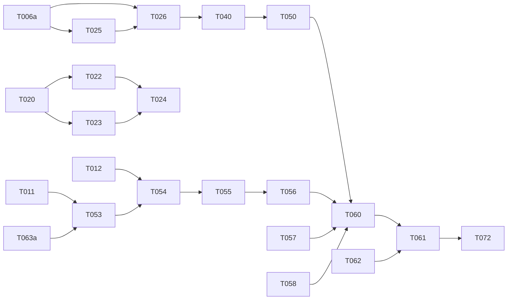

# 작업 목록 · 우선순위 (Tasks)

- 작성 2026-10-03 · 형식: spec-kit `tasks-template.md` (`[P]` = 다른 작업과 동시 진행 가능, `[USn]` = 관련 사용자 시나리오)
- 일정 기준: 추진계획서 2-4 + 중간고사 8주차(10/19~23, ML 10/20·TOPICS 10/21)
- 2026-11-18 출시 경로를 원스토어로 정함. Play 전용 항목(계정·비공개 테스터 14일·Play 선언·Play 심사)은 지움. 원스토어 요건 근거: [ONEconsole 가이드](https://onestore-dev.gitbook.io/dev)

## 우선순위를 정한 기준

1. **남이 처리해 줘야 끝나는 일(대기 시간)을 먼저** — 계정 가입, 스토어 검증은 내가 빨리 해도 줄어들지 않음
2. **다른 작업을 막는 결정을 다음으로** — ADR 2개가 정해져야 서버·앱 모듈 작업 시작 가능
3. **계획서 일정의 주차 산출물** — 6~7주차 "데이터셋", 9~10주차 "온디바이스 모델", 11주차 "원스토어 배포본"
4. 외부 일정: 원스토어 검증(심사) 기간은 가이드에 없음 → 제출 마감에서 넉넉히 역산해 등록 신청

## 단계 0 — 이번 주말~10/6 (외부 대기 시작)

- [x] T002 [P] 원스토어 개발자 계정(ONEconsole) 가입 (2026-11-18 완료) — 개인개발자, 무료, 14세 이상, 이메일 인증. 상세정보에 이름·영문 이름·휴대폰·주소·생년월일
- [x] T005 [P] MH-1M Figshare npz 다운로드(`~/data/mh1m`, md5 검증) + 라벨표 `ml/data_prep/mh1m_labels.py` → `ml/data/mh1m/labels.csv.gz` (2026-10-03)
  - npz 메타데이터에 VT 추천 위협 라벨이 있어 **Dataverse 라벨 12.3GB 불필요**. adware 58,067개(dowgin·kuguo·revmob·airpush 등 중국·구형 광고 SDK 위주, hiddenad 496) / 전체 악성 119,094 / 정상 1,221,421
  - inner npz 특징 11,961개 중 기기에서 뽑을 수 있는 건 **권한 166 + 인텐트 250**뿐(나머지 API 호출 11,545) → T020 스키마 어휘의 출발점
- [x] T006 [P] 할머니 폰 광고 원인 확인 (spec Q1) — **사후 확인 불가로 종료 (2026-10-14)**: 할머니 폰 광고는 디바이스 케어를 직접 실행해 이미 해결됨(자동 탐지는 작동 안 함). 앱 밖 전면 광고가 약 5초마다 또는 더 빠르게 나타났다는 관찰을 spec Q1·research.md에 기록. 원인 앱·표시 방식 확인 완료를 뜻하지 않으며, 원래 기기 재확인은 요구하지 않음.
- [ ] T006a [P] 별도 광고 피해 사례의 원인·표시 방식 확인 — 설치 앱에 의한 반복 광고, 브라우저·사이트 알림 등 가능성을 구분해 기록. T025·T026 평가셋 및 US10·FR-040 범위에 반영
- [ ] T007 [P] 갤럭시 실기기에서 삼성 인터넷 사이트 알림 채널 구조 확인 (spec Q7) — 사이트 하나 알림 허용 후 `adb shell dumpsys notification`의 채널 ID

## 단계 1 — 결정 (막힘 해소)

- [ ] T010 spec.md 검토 — 사용자 시나리오 우선순위·비목표 확인
- [x] T011 ADR-0001 서버 방식 선택 → **B: Ktor + Cloud Run + Neon** (2026-10-03)
- [x] T012 ADR-0002 보호자 앱 형태 선택 → **A: 한 앱 + 역할 선택** (2026-10-03)
- [x] T013 첫 git 커밋 (2026-10-06, 이후 PR 단위로 병합)

## 단계 2 — 6~7주차 10/5~10/16 · 계획서 산출물 "데이터셋"

데이터·특징 (US1의 기반)
- [x] T020 특징 스키마 v1 `ml/schema/feature_schema_v1.json` — **권한 121·인텐트 필터 91 확정**(2026-10-03, MH-1M 보유율 기준), 광고 SDK·이름 키워드 21개(2026-10-06)
  - 데이터: `ml/data_prep/mh1m_static.py` → `ml/data/mh1m/static.npz`(134만×416, 26초) + `vocab_stats.csv`
  - ⚠️ 계약 변경: 기기 인텐트 추출을 receiver 조회 → **매니페스트 직접 파싱**으로 (classifier.md §2)
- [x] T021 [P] 광고 SDK 태그 `ml/rules/ad_sdk_tags.csv` — 플래그 12종 + 개수용 11종, 접두어 대조, 최신 AAR 18종 매니페스트로 확인 (2026-10-06)
- [x] T022 [P] PC 특징 추출기 `ml/extract/extract.py` (androguard 4.1.4 고정) — 스키마 v1 특징 234개, 받는 중·깨진 APK는 건너뜀 (2026-10-07)
- [ ] T023 [P] 기기 특징 추출기 `core/packages` + `core/classifier/feature` — PackageManager 래퍼 + **base.apk 매니페스트(바이너리 XML) 파서**
- [ ] T024 일치 테스트 (APK 20개, 비트 단위) — T022·T023 이후
- [ ] T025 [P] 직접 수집: 광고·회색지대 앱 + 시니어 정상 앱 (원스토어·Play 인기 "클리너·부스터·와이파이" 장르)
  - Play 후보 497개 `ml/collect/` (검색어 20개, 로그인 없이 공개 검색), apkeep + 익명 공용 계정으로 다운로드 진행 중 (2026-10-07). 라벨링·원스토어 전용 앱은 남음
- [ ] T026 **평가용 테스트셋 분리·동결** `ml/label/` — 이후 학습에 절대 사용 안 함 (constitution VII)
  - 라벨은 에뮬레이터 관찰(R1~R6)로만 붙임. v1 = 150개(회색지대 100 + 시니어 50), 이후 버전별로 무작위 추가만 함 (2026-10-12). 광고 도배·정상 수(Recall·FPR 분모)는 관찰 후 확정해 여기에 적음
- [ ] T027 대조군 측정 절차 문서화: 같은 테스트셋을 시티즌코난·Play Protect로 검사하는 방법·기록 양식

앱 뼈대 (병행)
- [ ] T030 [P] minSdk 23 → 26 `build-logic/.../KotlinAndroid.kt`
- [ ] T031 [P] `core:model` 생성 — Verdict·RiskLevel·ReasonCode·AppInfo
- [ ] T032 [P] Room 엔티티 교체 — data-model.md §3 (`installed_app`, `verdict`, `symptom_event`, `usage_cursor`, `allow_entry`, `package_change_cursor`)
- [ ] T033 [US1] `sync:work` 변화 감지 작업 — getChangedPackages + bootCount
- [ ] T034 [US11] 증상 감지 `core/usage` — UsageStatsManager.queryEvents(`ACTIVITY_RESUMED`)로 조작 없는 포그라운드 전환을 앱별 귀속 (ADR-0003 주 경로). 조회 전에 사용 기록 권한 확인(없으면 `SecurityException`, 상태 보고만), 런처 별칭은 `targetActivity`로 풀기, 마지막 화면 꺼짐·직전 화면을 실행 사이에 저장
- [ ] T035 [US11] 전환 분류 휴리스틱(조작 직후 vs 조작 없음, FR-012, 규칙 v0 R1~R5 이식, 단위 테스트는 `testapps/poc/rule_v0.py`의 `_check` 사례) + 앱별 광고 횟수 기록·근거 생성(FR-010) → US4 가족 알림 트리거. 열린 요청은 근거 갱신(FR-023), 허용 앱은 notice 1번(FR-007)
- [ ] T036 [US11] 설치 시점 분류기에 `SYSTEM_ALERT_WINDOW` 사전 경고 신호 연결(FR-011) — 오버레이형 공백 보조

## 단계 3 — 8주차 10/19~23 (중간고사)

- [ ] T040 [US1] 베이스라인 학습 1회 (LightGBM) + 앱 단위 FPR ≤ 5%를 만족하는 최소 risk 임계값 기록 → spec Q4 판단 자료
- 그 외 작업 없음 (시험 우선)

## 단계 4 — 9~10주차 10/26~11/6 · "온디바이스 모델" + 연결 흐름 앞당김

> 계획서는 승인 흐름·UI를 11주차에 두었지만, **원스토어에 올릴 빌드**가 필요해 연결·승인 뼈대를 여기로 당김. 검증 승인 뒤 업데이트는 가능

- [ ] T050 [US1] 모델 개선 + INT8 변환 + LiteRT 이식 `core/classifier/model`
- [ ] T051 [US1] 기기 지연 측정 Microbenchmark (NFR-01)
- [ ] T052 [US2] 첫 전체 검사 화면 (O-S3)
- [ ] T053 [P] 서버 구현 — ADR-0001 결과, openapi.yaml 경로 순서: devices → pairing → alerts
  - [x] devices (`server/`, 인증·Idempotency-Key·오류 형식 공통 포함)
  - [x] pairing (연결 코드·연결, FCM 푸시 전송 공통 포함)
  - [x] alerts (생성·목록·응답·결과, 연결 해제 때 요청 삭제)
  - [x] 예약 작업 — 재알림 24시간·만료 7일·삭제 90일·연락 끊김 48시간·기기 180일 (Cloud Scheduler → `/internal/tick`, ADR-0001)
  - [ ] 배포 — Neon·GCP 결제 계정은 사람이 (server/README.md 배포 절)
- [ ] T054 [P] [US3] 연결 흐름 (O-S4, O-G2, S3) — `feature/pairing`. 기기 등록(`POST /devices`)은 연결을 시작할 때(연결 전 서버 전송 없음), "모든 데이터 지우기"는 `DELETE /devices/{id}` + Firebase 사용자 삭제 (개인정보처리방침 3·6절). 서버 통신은 `core:network`. 기반 완료: `core:data` FamilyRepository(첫 코드 요청·코드 입력 때 로그인·등록, 데이터 지우기), `Application.onCreate`에서 App Check 공급자 설치(디버그 Debug·출시 Play Integrity), 디버그만 `10.0.2.2` 평문 허용, FCM 자동 발급 끔·토큰 갱신. **출시 빌드는 가족 연결 꺼짐**(`FAMILY_ENABLED=false`, `app/src/release/AndroidManifest.xml`이 통신 권한 제거, `./gradlew test`가 확인) — 가족 연결 판 방침 시행 때 함께 켜고 릴리스 API 주소 넣기. FCM 토큰 갱신은 WorkManager로 재시도, 등록 뒤에만 FCM 자동 발급 켬. 시니어 화면 완료: `feature:senior-family`(O-S4 코드·QR — 화면이 보이는 동안 5초마다 연결 목록을 확인해 푸시 없이도 S3로, S3 연결 확인, S5 연결 관리·끊기 확인창), 첫 설정 마지막 단계 가족 연결 안내(건너뛰기 가능), 홈 [가족] 버튼·지켜보는 가족·놓친 연결 요청 카드, 푸시 `LINK_REQUESTED`·`LINK_REVOKED` 알림(채널 `link`). 보호자 화면 완료: O1 역할 선택(가족 연결이 켜진 빌드의 첫 실행만, 고른 역할은 기기 설정에 저장), `feature:guardian`(O-G1 Credential Manager Google 로그인 — 서버 전송 없음, 마친 뒤 알림 권한 요청 / O-G2 6자리 입력·Google 코드 스캐너 QR(카메라 권한 없음)·서버 오류별 안내 / O-G3 대기 — 5초마다 연결 상태 확인 / G1 연결 목록·마지막 검사 시각·연락 끊김 문구(검사 보고를 받은 연결만, 기준은 서버와 같은 max(보고, 연결 확정)+48시간)·연결 끊기·요청 취소·알림 꺼짐 안내), 푸시 `LINK_ACTIVATED`·시니어가 끊거나 거절한 `LINK_REVOKED` 알림, 보호자로 등록한 폰은 다시 로그인할 때 역할을 바꾸지 않음, 보호자 폰은 주기 검사 건너뜀. Google 로그인은 Firebase 콘솔에 디버그 서명 SHA-1 등록과 `google-services.json`의 웹 클라이언트 ID가 필요(없는 빌드는 "쓸 수 없어요" 안내). 남은 일: 시니어 표시 이름 입력(지금은 서버 기본 이름), 서버도 시니어=익명·보호자=Google 공급자 강제(지금은 익명 보호자만 거절), 보호자 Firebase 재로그인 필요 시 데이터 지우기 안내, 익명 오탐 신고 경로는 ID 토큰 없이(App Check만, T080)
- [x] T055 [US4] 보호자 요청 상세·응답 (G1, G2) — `feature/guardian-*`. 시니어 쪽 완료: 열린 확인 요청을 `POST /alerts`(source symptom)로 보내고 근거가 늘면 다시 보냄(서버 open일 때만, 만료됐으면 새 요청), 보호자 응답은 푸시 `DECISION_MADE`(DB만 반영 후 알림)와 `GET /alerts?updatedSince` 당겨 오기 둘 다로 받음, S2에 "민지님이 지우자고 했어요"+한마디 / 답 기다리는 중엔 테두리 [지금 지울래요] / 허용이면 "가족이 괜찮다고 했어요", 허용 목록(`allow_entry`)과 허용 앱의 notice 1번(FR-007), 처리 결과 `POST /alerts/{id}/outcome`(보내기 전에 서버 상태를 읽어 맞는 결과만), 새 보호자 연결 시 열린 요청 다시 보냄, Room 판 2(자동 이전). 보호자 쪽 완료: G1 "답을 기다리는 요청" 카드·[지난 요청 보기], G2 상세(앱·설치 정보·감지 근거·한마디 40자·[괜찮은 앱이에요]/[지우자고 하기], 알림 전용은 [지우자고 하기]만, "△△님이 먼저 답했어요", 결과·만료 표시), G3 기록(알림 전용은 "경고 앱"), 푸시 ALERT_CREATED·REMINDER·NOTICE·RESOLVED 알림(채널 alerts·notice·result, 탭하면 G2), 응답 재전송은 같은 키. 요청 목록은 화면을 열 때 서버에서 읽는다(오프라인 사본 `alert_cache`는 두지 않음). 시니어가 시스템 창에서 취소한 것(declined)은 지금처럼 다시 지울 수 있게 두고 서버에 보내지 않음
- [x] T055a [US4] 연락 끊김 경고 (F6, 서버 판정·알림은 T053 예약 작업으로 완료) — 시니어 `PUT /devices/{id}/status` 6시간 간격 보고 + 서버 `lastCheckedAt` 48시간 판정 + G1 경고 카드(권한 꺼짐 표시 포함) + 보호자 알림 1회. 시니어 6시간 보고 완료(검사 뒤 가족 동기화 작업이 마지막 검사 시도 시각과 알림·사용 기록·알림 접근 권한 상태를 보냄). G1 연락 끊김 문구(서버와 같은 max(보고, 연결 확정)+48시간, 보고를 받은 연결만)·권한 꺼짐 표시(사용 기록·알림), CONTACT_LOST 알림 완료
- [ ] T056 [US5] 시니어 삭제 유도 (S2) + PackageInstaller.uninstall
- [ ] T057 [P] 개인정보처리방침 공개 — 지금 판 `docs/privacy-policy.md`(인터넷 권한 없음, 기기 밖 전송 없음 기준). 가족 연결 판 초안 `docs/privacy-policy-family.md`(서버 코드와 대조, 출시 전 `[확인 필요]` 채우고 앱 동작 다시 대조). 공개 주소(GitHub Pages 등)는 확인 후. 서버를 붙이면 다시 고침
- [x] T058 [P] 공개 고지 화면 (O-S1, FR-041) — 첫 설정 1단계 "폰주치의가 하는 일" (PR #5)
- [ ] T059 [US10] Chrome 사이트 광고 알림 끄기 — 알림 리스너(Chrome 외 알림 즉시 폐기) + 사이트별 기록 + 판정 + 채널 설정 화면 열기 (FR-050~054). 알림 접근 공개 고지는 T058에 포함
- [ ] T059a [US10] 알림 접근 미허용 대체 안내 화면 (S6, FR-040)

## 단계 5 — 11주차 11/9~13 · 출시

- [ ] T060 원스토어 바이너리 준비 — 릴리스 서명은 우리 키 유지("기존 키" 또는 서명된 APK 직접 등록. 원스토어 관리 키로 재서명하면 App Check에 등록한 SHA-256과 달라짐), APK 또는 AAB(AAB를 고르면 APK로 못 돌림, AAB는 minSdk 21 이상 → 지금 26), targetSdk 33 이상 권장(설치 차단 팝업 방지 → 지금 36), 2GB 이하
- [ ] T061 원스토어 앱 등록·검증 요청 — 필수: 상품 제목(50자), 기본 언어, 패키지 네임(`io.github.inq_o.phonedoctor`, 등록 뒤 변경 불가). 서비스 구분 "정식"(베타게임존은 게임 전용·패키지 재사용 불가). 검증 반려는 결과서와 함께 메일로 옴
- [ ] T062 원스토어 심사 가이드라인 점검 — 개인정보 보호·보안(처리방침 공개, 접근권한 최소화)과 앱 기능 조항. `QUERY_ALL_PACKAGES`·사용 기록·앱 삭제 요청의 용도 설명, 개인정보처리방침 URL 입력 필요 여부를 ONEconsole 등록 화면에서 확인
- [ ] T063 Android 개발자 인증(Google) 확인 — 원스토어 안내: 인증 안 한 앱은 2027년부터 Android 기기 설치 제한. 과제 기간 영향과 절차 확인
- [x] T063a 서버 인증의 App Check 공급자 재검토 — Play Integrity 그대로, Firebase에서 "Google Play 밖에서만 배포" 설정(PLAY_RECOGNIZED 불필요, 최소 기기 무결성). Play Console 없이 Cloud Console에서 API 사용 설정. ADR-0001 보완(2026-11-18)
- [ ] T064 [US6] 근거 문구 시니어·보호자 2종 적용

## 단계 6 — 12~13주차 · 검증·보고

- [ ] T070 대조군 비교 실험 (SC-001·SC-002)
- [ ] T071 사용성 관찰: 설치 대행자 3명 (SC-003), 시니어 1명 이상 (SC-004)
- [ ] T072 원스토어 검증 승인·판매 개시 확인, 배포 링크를 보고서에 기재
- [ ] T073 최종보고서 (13주차, spec Q6 면제 여부 확인)
- [ ] T074 [US11] 증상 감지 평가 (SC-002) — 앱 밖 광고 확인 앱으로 recall, T026 정상 앱을 실제 실행해 정상 알림 탭·직접 실행 등 정상 `ACTIVITY_RESUMED` 이벤트를 라벨링하고 전체 정상 이벤트를 분모로 이벤트 단위 오탐률(FR-012) 계산, 같은 실행에서 기기·일당 오경고 수도 집계(spec §4 지표 정의). 대기 버킷이 낮아지는 조건(rare 등)의 WorkManager 실행 간격과 감지 지연도 측정. 오버레이형은 커버리지 한계로 명시

## 나중에 (P2·P3)

- [ ] T080 [US7] 오탐 익명 신고
- [ ] T081 [US8] 강력 모드 (testdpc 참고)
- [ ] T082 FR-042 AppFunctions — compileSdk 37 필요
- [ ] T083 [US6] Gemini Nano 문장 다듬기
- [ ] T084 [US9] 주간 리포트·구독
- [ ] T085 [US10] Chrome 내장 팝업·리디렉션·침입 광고 차단 켜는 법 안내 (FR-055, 페이지 안 광고 대응)

## 의존 관계

