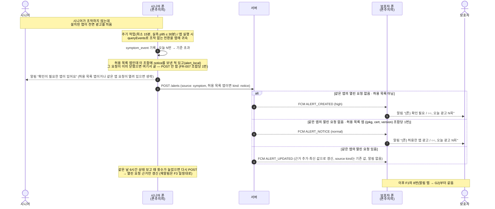
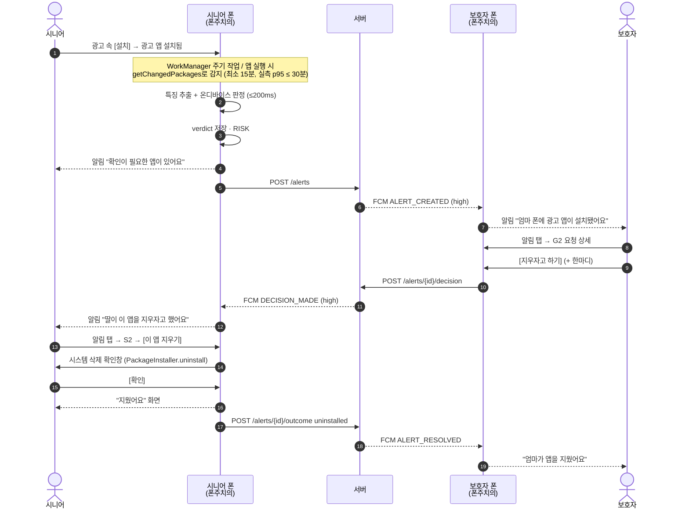
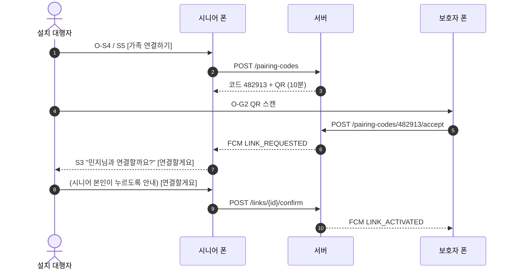
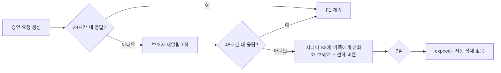
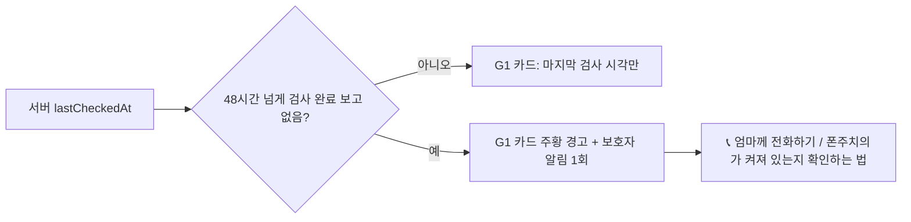

# UI/UX 흐름

- 대상: 시니어 기기(보호 대상) · 보호자 기기 · 설치 대행자(첫 설정)
- 근거·출처: [research.md](research.md) §3 디자인 기준
- 화면 ID 규칙: `S`=시니어, `G`=보호자, `O`=온보딩(공통)
- **Figma 시안(11화면, 2026-10-03)**: https://www.figma.com/design/UcNiV8MvfXp6NazfkBB5KG — 토큰 변수·텍스트 스타일·컴포넌트(시니어/보호자 버튼, 상태 원, 상태 칩) 포함.

---

## 1. 설계 원칙

| # | 원칙 | 적용 | 근거 |
|---|---|---|---|
| 1 | 한 화면, 주요 행동 1개 | 시니어 화면의 채운 버튼은 1개. 나머지는 **테두리 버튼**이나 테두리 메뉴 칸(글자만 있는 버튼 금지). 버튼이 2개면 반씩 가로로 나란히(아래 "버튼 쌍"). 예외: S1′는 앱 카드가 주요 행동이라 채운 버튼이 없음, 기다리는 화면(연결 코드, 보호자 답 대기)은 채운 버튼 없이 아래쪽에 [나중에]를 반드시 둠 (2026-11-25) | 서울시 고령층 접근성 표준 지침 2·3 (필수 요소, 단순한 구조) · 늘다 관찰: 시니어는 글자로 된 UI를 누를 수 있다고 인식하지 않음 [R1] |
| 2 | 전화로 설명할 수 있는 화면 | 색·위치·버튼 문구를 고정 ("아래쪽 빨간 버튼 누르세요"). 시니어 화면에서 **Dynamic Color 끔** | 보호자가 전화로 안내하는 상황 (페르소나) |
| 3 | 겁주지 않기 | "위험!", "해킹" 대신 "확인이 필요한 앱이 있어요". 결정은 권유형 | 토스 라이팅 원칙 6 (Suggest than force), 지침 10 (심리적 부담) |
| 4 | 되돌릴 수 있게 | 허용 → 나중에 다시 검사 가능, 연결 해제 → 다시 연결 가능, 삭제 전 시스템 확인창 | 지침 9 (오류 예방·복구) |
| 5 | 상태가 보이게 | 홈 맨 위에 상태 문장 1개 + 마지막 검사 시각 | 지침 5 (시스템 상태 가시성) |
| 6 | 시간 제한 없음 | 시니어 화면에 타이머·자동 닫힘 없음 (연결 코드 10분은 보호자 화면 쪽에서 재발급 유도) | 고령자 디자인 체크리스트(ISO 25556) 금지 항목 |
| 7 | 시스템 설정 존중 | 시스템 글꼴·글꼴 크기 그대로 사용(삼성 사용자 글꼴 포함), sp 단위, 200%에서 잘림 없음 | Android 14 비선형 글꼴 배율 최대 200% |
| 8 | 누르는 건 아래, 읽는 건 위 | 시니어 화면의 버튼은 화면 아래쪽에 고정. 홈의 누르는 영역(메뉴 칸, 광고 찾기 꺼짐의 [켜러 가기])은 아래쪽에 두되 고정하지 않음(아래 §2 예외). 위쪽은 상태 문장·설명. 위쪽 구석에 작은 버튼(설정 등)을 두지 않음 | 삼성 One UI 화면 구성(보기 영역/조작 영역), 엄지 닿는 범위 [R1] |
| 9 | 지금 몇 단계인지 | 온보딩 화면 맨 위에 "2/4" 대신 문장으로 "4단계 중 2단계" | 늘다 관찰: 어떤 단계에 있는지 인식하지 못함 [R1] |

**보호자 화면** (2026-11-25): 보호자는 스마트폰을 보통으로 쓰는 사람이라 흔한 앱 모양을 따른다. 위 막대에 뒤로(←), 홈 오른쪽 위에 설정 톱니. 원칙 1·8(시니어 전용)은 적용하지 않고 "화면당 가장 강조된 버튼 하나"(KRDS)만 지킨다. 목록은 흰 띠 + 구분선으로 묶고, 같은 테두리 카드를 늘어놓지 않는다. 강조색은 주요 행동과 상태에만 쓴다. 빨강은 시니어 폰의 실제 [지우기]에만 쓰고, 보호자의 [삭제 요청]은 파랑(primary) (§8 R10~R13)

**버튼 쌍** (2026-11-25): 시니어 화면에서 고르는 버튼이 2개면 화면 아래에 반씩 가로로 둔다. 왼쪽은 물러나기([나중에], [안 할래요]), 오른쪽은 주요 행동. 시스템 삭제 창 [취소 | 확인]과 같은 순서라 이어서 봐도 헷갈리지 않는다. 글꼴을 키워 한 줄에 안 들어가면 세로로 쌓고 주요 버튼을 아래에 둔다(Android 대화상자와 같은 방식). S2·S3·연결 코드·G2에 공통 적용

## 2. 정보 구조 (IA)

```
폰주치의 (한 앱, 첫 실행에서 역할 선택 — ADR-0002 안 A 기준)
├─ O 온보딩 (공통)
│   ├─ O1 역할 선택: "이 폰을 지켜요" / "가족 폰을 지켜요"
│   └─ (역할별 분기)
│
├─ 시니어 모드
│   ├─ O-S1 무엇을 하는 앱인지 (공개 고지, FR-041)
│   ├─ O-S2 권한: 알림 → 사용 기록 (앱 밖 광고 찾기, 주 경로) → (선택) 알림 접근 (사이트 광고 알림, US10)
│   ├─ O-S3 첫 전체 검사 (US2)
│   ├─ O-S4 가족 연결 코드·QR (US3)  ← 건너뛰기 가능
│   ├─ S1 홈
│   ├─ S2 앱 상세 · 삭제 유도 (US5)
│   ├─ S3 연결 확인 "○○님과 연결할까요?"
│   ├─ S4 검사 기록
│   ├─ S5 가족 연결 관리 (코드 다시 받기, 연결 끊기) ← 홈 [가족] 칸
│   ├─ S6 광고 알림 끄는 법 (FR-040)
│   └─ S7 설정 (글자 크기 미리보기, 강력 모드, 데이터 지우기) ← 홈 [설정] 칸
│
└─ 보호자 모드
    ├─ O-G1 Google 로그인
    ├─ O-G2 QR 스캔 / 6자리 입력
    ├─ O-G3 연결 요청 대기 ("연결 요청을 보냈어요")
    ├─ O-G4 표시 이름 고르기 (연결 직후 한 번, 건너뛸 수 있음)
    ├─ G1 홈 (지켜보는 폰 상태 + 답변할 요청 + 지난 요청·폰 추가 연결, 연결 끊김 F6)
    ├─ G2 요청 상세 · 응답 (US4)
    ├─ G3 지난 요청 (날짜별, 결과 배지 하나. 알림 전용 요청은 '허용한 앱의 광고')
    └─ G4 설정 (연결된 폰 > 표시 이름·연결 끊기, 알림, 계정)
```

- 하단 탭 없음. 시니어 홈은 **스크롤 없는 한 화면**, 보호자 홈은 목록
- **보호자 화면의 상대 폰 이름** (2026-11-25): 부모님·엄마·시니어 같은 역할을 문구에 박지 않는다(사용자마다 관계가 다름). 이름은 아래 순서로 정한다.
  1. 보호자가 O-G4·G4에서 고른 표시 이름(엄마, 아빠, 할머니, 할아버지, 직접 입력). 보호자 폰에만 저장하고 서버로 보내지 않는다
  2. 상대가 S7에서 정한 이름 → "{이름}님 폰"
  3. "연결한 폰"
  - 폰은 "{표시 이름} 폰", 사람은 표시 이름 그대로. 연결 전 화면은 "상대 폰"·"지켜볼 폰"
  - 근거: Life360은 구성원이 정한 이름("Dad"도 사용자가 붙인 이름), Family Link는 사람별 요청·설정, 삼성 SmartThings Find는 "구성원" 같은 중립어 (§8 R13)
  - 예외(2026-11-25): 시스템 글꼴을 크게 해서 한 화면에 들어가지 않으면 위쪽(읽는 영역)만 스크롤하고, 줄 버튼(채운·테두리 버튼)은 아래에 고정한다
  - 홈의 누르는 영역(메뉴 칸, 그 위의 [켜러 가기])은 고정하지 않는다(2026-11-25): 자리가 남으면 바닥에 붙고, 넘치면 읽는 영역 아래에 이어 붙어 같이 스크롤한다. 고정하면 글꼴 200%에서 2×2 칸이 화면 대부분을 차지해 S1′ 앱 카드를 가렸다(S10+ 실측). 보통 크기에서는 보이는 모습이 같다. 근거: 메뉴가 많은 홈은 전체를 스크롤하고 바닥 고정은 주요 버튼 1~2개에만 쓰는 일반 관행, WCAG 1.4.4·1.4.10(키운 글자로 내용이 가려지면 안 됨) (§8 R9)

## 3. 핵심 흐름

### F1′. 앱 밖 광고 감지 → 승인 → 삭제 (주 흐름, 시연 시나리오 — US11)



- 오버레이형 광고는 사용 기록에 안 남아 이 흐름으로 못 잡음 → 설치 시점 F1의 `OVERLAY_PERMISSION` 사전 경고가 보조 (ADR-0003 한계)

### F1. 설치 → 판정 → 승인 → 삭제 (설치 시점 사전 경고, 보조 — US1)



- ⚠️ 백그라운드에서 삭제 창을 바로 띄우는 건 **Android 백그라운드 액티비티 실행 제한**으로 불가 → 반드시 **시니어가 알림을 탭**해서 앱이 앞으로 나온 뒤 띄움
- 보호자가 [괜찮은 앱이에요]를 누르면 13~19 대신: 시니어 폰 허용 목록 추가, 시니어 알림 없음(이미 뜬 알림은 "가족이 괜찮다고 했어요"로 교체)

### F2. 가족 연결



- 시니어 확인 단계는 정책 근거(시니어 본인 동의)이자 오연결 방지. 생략 불가

### F3. 보호자 무응답



- 알림 전용 요청(`kind: notice`)은 재알림·시니어 안내 없이 7일 뒤 expired

### F4. 연결 끊기 (시니어)

홈 [가족] → S5 가족 연결 → 이름 옆 [연결 끊기] → 확인창 "민지님과 연결을 끊을까요? 민지님은 더 이상 알림을 받지 않아요" [연결 끊기]/[그대로 두기] → `DELETE /links/{id}` → 완료 문구

### F5. 강력 모드 (P3, 시연 기기 전용)

공장 초기화 → 설정 마법사에서 화면 6번 탭 → QR 스캔(프로비저닝 페이로드) → 폰주치의가 Device Owner로 설치 → 이후 F1의 15번 단계에서 **승인 즉시 앱 정지**, 시니어 S2에는 "가족이 이 앱을 잠시 멈췄어요" + [이 앱 지우기]

### F6. 연락 끊김 (보호자에게 알림)

시니어 폰이 폰주치의를 지웠거나, 알림을 껐거나, 꺼져 있으면 보호자는 "아무 일 없음"과 "보호가 멈춤"을 구분할 수 없다. 오탐을 줄이려고 조용히 두는 설계라 더 필요하다.



- 기준 48시간: WorkManager 최소 주기(15분)·Doze 지연과 6시간 간격 상태 보고를 넉넉히 넘는 값. 실측 후 조정
- 요청이 없다는 것만으로 "지워졌다/꺼졌다"를 확정하지 않음 → 문구는 가능성 표현 유지. 권한이 꺼진 경우는 상태 보고(`protection`)로 따로 보여 줌: "{폰} 앱 밖 광고 찾기 꺼짐"
- 근거: 부모 통제 앱 사례의 "Monitoring gaps" 카드 [R2]
- 서버 쪽 판정 → 예약 작업(15분 간격)이 시니어 기기의 `lastCheckedAt`(openapi `Link.lastCheckedAt`으로 보이는 값, 보고가 없으면 연결 확정 시각) 기준으로 판정해 보호자에게 `CONTACT_LOST` 1번 (push-messages.md). 시니어 기기는 `PUT /devices/{id}/status`로 마지막 검사 시각·권한 상태를 6시간 간격 보고 (T055a). 다른 요청만 오는 기기(`lastSeenAt`만 갱신)는 정상으로 보지 않음

## 4. 화면 와이어프레임 (ASCII, 360dp 폭 기준)

> 레이아웃 가설 확인용. humbleteam/ascii-wireframes 방식(구현 전 텍스트 스케치)

### S1 시니어 홈 — 정상

```
┌──────────────────────────────┐
│ 폰주치의                       │  ← 상단바 56dp, 버튼 없음 (원칙 8)
├──────────────────────────────┤
│        ( ✓ 큰 초록 원 )        │  ← 120dp, 아이콘+색 (색만 쓰지 않음)
│    지금은 확인할 앱이 없어요     │  ← 28sp Bold
│    오늘 오전 9:12에 살펴봤어요   │  ← 20sp
│    지켜보는 가족: 민지          │  ← 20sp, 정보만 (연결 없으면 §6 "연결 없음" 문구)
│                              │  ← 위: 읽는 영역 / 아래: 누르는 영역 (원칙 8)
│ ┌────────────┐ ┌────────────┐ │
│ │  살펴보기   │ │  검사 기록   │ │  ← 메뉴 칸 2×2, 최소 104dp, 아이콘 32 + 22sp
│ └────────────┘ └────────────┘ │     [살펴보기]만 채움 (주요 행동 1개)
│ ┌────────────┐ ┌────────────┐ │
│ │    가족     │ │    설정     │ │  ← S5, S7로 감
│ └────────────┘ └────────────┘ │
└──────────────────────────────┘
```

- 근거(2026-11-25): 삼성 쉬운 사용 모드·애플 Assistive Access·시니어 런처 모두 홈이 큰 칸 메뉴판이고 설정을 구석의 작은 버튼으로 두지 않음 (§8 R4·R5)

### S1′ 시니어 홈 — 확인 필요

```
┌──────────────────────────────┐
│ 폰주치의                       │
├──────────────────────────────┤
│        ( ! 큰 주황 원 )        │
│   확인이 필요한 앱이 1개 있어요  │  ← 28sp
│   민지님께도 알렸어요            │
│ ┌──────────────────────────┐ │
│ │ [아이콘] 초고속 클리너      › │ │  ← 카드 전체가 버튼 = 주요 행동 (주황 테두리)
│ │ 광고를 많이 띄우는 앱이에요   │ │
│ │ 눌러서 살펴보세요            │ │  ← 누를 수 있다는 단서 (R1)
│ └──────────────────────────┘ │
│ ┌────────────┐ ┌────────────┐ │
│ │  살펴보기   │ │  검사 기록   │ │  ← S1과 같은 자리·같은 이름, 모두 테두리
│ └────────────┘ └────────────┘ │
│ ┌────────────┐ ┌────────────┐ │
│ │    가족     │ │    설정     │ │
│ └────────────┘ └────────────┘ │
└──────────────────────────────┘
```

- 증상 감지(US11)에서 온 경우 카드 둘째 줄은 "오늘 광고를 {n}번 띄웠어요 ›" (위 예시는 설치 시점 판정)
- **"오늘" 표기 규칙(증상 문구 공통)**: 근거의 `symptom.date`가 보는 날의 오늘이면 "오늘", 아니면 "{M}월 {d}일에". S1′·S2·G2·알림 모두 같음

### S2 앱 상세 · 삭제 유도 (보호자 승인 후)

```
┌──────────────────────────────┐
│ ← 뒤로                         │
├──────────────────────────────┤
│       [ 앱 아이콘 96dp ]        │
│        초고속 클리너             │  ← 28sp
│                              │
│ ┌──────────────────────────┐ │
│ │ 💬 민지(딸)                 │ │  ← 보호자 한마디 (있을 때만)
│ │ "엄마 이거 광고 앱이에요"     │ │
│ └──────────────────────────┘ │
│                              │
│  이런 점이 걱정돼요              │  ← 22sp
│  • 광고를 많이 띄우는 앱이에요    │  ← 근거 최대 3개, 20sp
│  • 다른 앱 위에 화면을 띄울 수 있어요│
│  • 앱 화면에 아이콘이 안 보여요   │
│                              │
│ ┌────────────┐ ┌────────────┐ │
│ │   나중에    │ │ 🗑 지우기   │ │  ← 버튼 쌍: 왼쪽 테두리, 오른쪽 채운 빨강
│ └────────────┘ └────────────┘ │     (시스템 삭제 창 [취소 | 확인]과 같은 순서)
└──────────────────────────────┘
```

- 증상 감지에서 온 경우 첫 근거는 "오늘 광고를 {n}번 띄웠어요"이고, 설치 시점 판정 근거가 있으면 그 아래에 붙음
- 승인 전(보호자 응답 대기)에는 빨간 버튼 대신 안내 문장 "민지님 답을 기다리고 있어요" + 버튼 쌍 [나중에 | 지금 지울래요] (둘 다 테두리, 시니어 본인 결정권 유지)
- 근거가 1개면 글머리표 없이 문장으로

### S3 연결 확인

```
┌──────────────────────────────┐
│                              │
│   민지님과 연결할까요?           │  ← 28sp
│                              │
│   연결하면 위험한 앱이 생겼을 때  │  ← 20sp
│   민지님 폰에도 알림이 가요.      │
│   다른 앱 목록·사진·문자는        │
│   보내지 않아요.                │
│                              │
│ ┌──────────────────────────┐ │
│ │         안 할래요            │ │  ← 테두리 버튼
│ └──────────────────────────┘ │
│ ┌──────────────────────────┐ │
│ │        연결할게요            │ │  ← 채운 버튼, 맨 아래
│ └──────────────────────────┘ │
└──────────────────────────────┘
```

### G1 보호자 홈

```
┌──────────────────────────────┐
│ 폰주치의                    ⚙ │  ← 22sp, 오른쪽 위 설정 (보호자는 흔한 앱 모양)
│                              │
│ (!) 엄마 폰                   │  ← 상태 원 56 + 폰 이름 14sp
│     확인 필요 1건              │  ← 상태 22sp Bold (시니어 폰과 같은 상태 원·색)
│     마지막 검사 오늘 11:30      │  ← 14sp
│                              │
│ 답변할 요청                    │  ← 묶음 제목 14sp
│ ┃[앱] bgad                  › ┃  ← 흰 띠 한 줄 전체가 눌림, 72dp
│ ┃     오늘 광고 12회, 마지막 10:28┃
│                              │
│ ┃ 지난 요청                 › ┃
│ ┃ 폰 추가 연결               + ┃
└──────────────────────────────┘
```

- 폰이 2대 이상: "지켜보는 폰" 묶음에 폰마다 한 줄(상태 원 40 + 이름 + 상태 + 마지막 검사), 요청 줄 부제는 "{폰}, 오늘 광고 12회"
- 연결 끊김(F6): 상태 "연결 끊김"(주황 원), 한 줄 "폰주치의가 삭제되었거나 알림이 꺼져 있을 수 있어요" + [확인 방법 보기] 링크. 요청 묶음은 "다시 연결되면 요청을 보여 드려요". 전화 버튼 없음(번호를 모르고, 전화는 따로 할 수 있음)
- 연결된 폰 0대: "연결된 폰이 없어요" + "지켜볼 폰의 폰주치의에서 연결 코드를 받아 입력하세요" + [폰 연결] (채움, 화면의 유일한 강조 버튼)
- 표시 이름을 건너뛴 연결이 있으면 "지켜보는 폰" 아래 "표시 이름 정하기 ›" 한 줄

### G2 보호자 — 요청 상세

```
┌──────────────────────────────┐
│ ←  엄마 폰                     │  ← 18sp
│ [아이콘] bgad                  │  ← 22sp Bold
│         [확인 필요]             │  ← 배지 (§5 배지 토큰)
│ 감지 내용                      │
│ ┃ 사용 중이 아닐 때 광고  오늘 12회┃  ← 흰 띠 표
│ ┃ 처음                  02:25 ┃
│ ┃ 마지막                10:28 ┃
│ ┃ 설치               11월 20일 ┃
│ 판정 근거 (설치 시점 근거가 있을 때) │
│ ┃ 광고 SDK 7개 포함 …          ┃
│ 광고 판단은 틀릴 수 있어요        │  ← 14sp
│ 자세히 보기 ▾                   │  ← 패키지·버전·감지 규칙·점수·모델 (접힘)
├──────────────────────────────┤
│ 같이 보낼 메시지 (선택)          │  ← 라벨 보임, 최대 40자, 글자 수
│ [                          ] │
│ 삭제 요청과 함께 전달돼요   0/40 │
│ 허용하면 이 버전은 다시 묻지 않아요. 답은 바꿀 수 없어요 │
│ ┌──────────┐ ┌─────────────┐ │
│ │   허용    │ │  삭제 요청   │ │  ← 48dp, 오른쪽이 주요 행동(파랑 채움)
│ └──────────┘ └─────────────┘ │
└──────────────────────────────┘
```

- 근거 표시: `install_scan`만 있으면 판정 근거만, `symptom`만 있으면 감지 내용만, 둘 다 있으면 감지 내용 위·판정 근거 아래. "광고 뜬 날 N일" 줄은 `symptom.days`가 2 이상일 때만
- 알림 전용 요청(`kind: notice`): 배지 [허용한 앱], 맨 위 "허용한 앱이 다시 광고를 띄웠어요", 버튼은 [삭제 요청] 하나
- 이미 끝난 요청: 버튼 자리 대신 결과. 다른 보호자가 먼저 답함 → "{보호자}님이 먼저 답했어요", 7일 무응답 → "답변 기한 지남"
- 보낸 뒤: 배지 [삭제 요청]·[허용], "삭제 요청을 보냈어요" + "{폰}에서 알림을 누르면 삭제 화면이 열려요", 진행 표(삭제 요청 시각 / 결과: 대기 중·삭제됨·삭제 안 함·이미 삭제됨·기한 지남), 보낸 메시지, "결과가 나오면 알림으로 알려 드려요"
- 보내기 실패: 버튼 위 오류 상자(role=alert) "보내지 못했어요. 인터넷 연결을 확인하고 다시 눌러 주세요", 입력한 메시지 유지. App Check 실패는 "폰주치의 서버가 이 폰을 확인하지 못했어요"

### G3 지난 요청 · G4 설정 · O-G3 · O-G4

- G3: 날짜 묶음(오늘, 11월 3일) 아래 흰 띠 목록. 줄 = 앱 이름 16 Bold / "{폰}, {내용}" 14 / 결과 배지 하나(답변 대기·삭제 요청·허용·삭제됨·기한 지남) / ›
- G4: 묶음 "연결된 폰"(줄마다 "{폰}" / "{이름}님, {날짜} 연결" ›, 누르면 표시 이름 바꾸기·연결 끊기), "알림"(주의 앱 알림, 판정 개선 참여 — 스위치 + 한 줄 설명), "계정"(표시 이름, 데이터 삭제 — 빨간 글자). 연결 끊기·데이터 삭제는 확인창(제목 "{폰} 연결을 끊을까요?", 결과 한 문장, [취소 | 연결 끊기])
- O-G3: 대기 원 + "연결 요청을 보냈어요" + "{이름}님 폰에서 수락하면 연결돼요" + [닫기]. 거절되면 "연결 요청이 거절됐어요" + [새 코드 입력]
- O-G4: "{이름}님 폰과 연결됐어요" + "이 폰에서 부를 이름을 고르세요. 이 폰에만 저장돼요" + 칩(엄마·아빠·할머니·할아버지·직접 입력, 미리 고르지 않음, 직접 입력은 입력칸 10자) + "고르지 않으면 '{이름}님 폰'으로 표시돼요" + [건너뛰기 | 저장]. 연결 직후 처음 앱을 열 때 한 번

## 5. 디자인 토큰

- 출발점: ui-ux-pro-max `--design-system` 결과 ("Trust & Authority", 차분한 파랑 + 안심 초록) → M3 역할로 매핑. 글꼴 추천(Atkinson Hyperlegible)은 한글 미지원이라 **시스템 글꼴** 사용

| 토큰 (M3 역할) | 값 | 용도 |
|---|---|---|
| `primary` | #0369A1 | 주요 버튼, 링크 |
| `onPrimary` | #FFFFFF | 대비 5.9:1 |
| `tertiary` (safe) | #15803D | "안전해요" 상태 원 |
| `error` (risk) | #B91C1C | 위험 상태, 삭제 버튼 (흰 글자 대비 6.5:1) |
| `warning` (caution, 확장) | #B45309 | 확인 필요 상태 |
| `background` | #F8FAFC | |
| `onBackground` | #0F172A | 본문 대비 17:1 (7:1 이상) |
| `surface` | #FFFFFF | 카드·테두리 버튼 바탕 (`onBackground` 글자 17.9:1) |
| `surfaceVariant` | #E2E8F0 | 앱 아이콘 자리, 가족 한마디 상자 (`onBackground` 글자 14.5:1) |
| `outline` | #475569 | 테두리 버튼·카드 테두리 (바탕 대비 7.2:1, 면 대비 7.6:1) |

| 타이포 | 시니어 | 보호자 |
|---|---|---|
| 상태 문장 | 28sp Bold | 22sp Bold |
| 제목·앱 이름 | - | 18sp Bold |
| 본문 | 20sp, 줄간격 1.5 | 16sp |
| 버튼 | 22sp Bold | 16sp SemiBold |
| 보조(묶음 제목, 시각, 설명) | - | 14sp |

| 크기 | 시니어 | 보호자 |
|---|---|---|
| 주요 버튼 높이 | 64dp | 48dp |
| 홈 메뉴 칸 | 최소 104dp, 2열, 아이콘 32dp + 22sp Bold, 간격 16dp (고정 높이 아님) | - |
| 최소 터치 영역 | 56dp | 48dp (M3) |
| 터치 대상 간격 | 16dp | 8dp |
| 좌우 여백 | 24dp | 16dp |

- **배지** (보호자, 2026-11-25): 글자색은 상태색보다 진하게 해 14sp 배지도 본문 기준 7:1을 넘긴다(§7). 색만으로 구분하지 않고 글자를 넣는다(KRDS)

| 배지 | 라이트 글자 / 바탕 | 대비 | 다크 글자 / 바탕 | 대비 |
|---|---|---|---|---|
| 확인 필요·답변 대기 | #78350F / #FEF3C7 | 8.15 | #FDE68A / #451A03 | 12.03 |
| 삭제 요청·실패 | #7F1D1D / #FEE2E2 | 8.20 | #FECACA / #450A0A | 11.16 |
| 허용 | #14532D / #DCFCE7 | 8.30 | #BBF7D0 / #052E16 | 12.30 |
| 선택한 칩 | #0C4A6E / #E0F2FE | 8.24 | #BAE6FD / #082F49 | 10.46 |
| 삭제됨·기한 지남 | #0F172A / #E2E8F0 | 14.48 | #F8FAFC / #334155 | 9.90 |

- 시니어 테마는 Dynamic Color 끔, 다크 모드는 시스템 따름(같은 대비 기준)
- 다크 모드 값: `primary` #7DD3FC, `onPrimary` #082F49, safe #86EFAC, risk #FCA5A5, caution #FCD34D, `background` #0F172A, `onBackground` #F8FAFC, `surfaceVariant` #334155(글자 9.9:1), `outline` #CBD5E1(바탕 12.0:1)은 앱 코드 `Color.kt`와 같음. `surface` #1E293B(글자 14.0:1, 테두리 9.9:1)는 새로 정함(지금 코드는 바탕과 같은 #0F172A)
- S1 상태 문장은 "휴대폰이 안전해요" 대신 "지금은 확인할 앱이 없어요"(2026-11-25). 폰주치의가 모든 위험을 찾는 것은 아니라 "안전해요"는 과장이라서. 상태 원의 읽기 이름도 "확인할 앱 없음"
- 대비 수치는 WCAG 상대 휘도 공식으로 계산함(2026-10-03). 흰 글자 기준 초록·주황 5.0:1은 버튼 글자(22sp Bold = 큰 글씨)로만 쓰고 본문 글자색으로는 안 씀
- 구현 후 Accessibility Scanner로 실제 화면 재측정

## 6. 문구 덱 (Copy deck)

| 위치 | 문구 | 비고 |
|---|---|---|
| 시니어 알림 (RISK) | 제목 "확인이 필요한 앱이 있어요" / 본문 "{앱이름} — 눌러서 살펴보세요" | "위험", "해킹" 안 씀 |
| 시니어 알림 (증상) | 제목 "확인이 필요한 앱이 있어요" / 본문 "{앱이름}이(가) 오늘 광고를 {n}번 띄웠어요" | US11 |
| 시니어 알림 (승인) | "{보호자}님이 {앱이름}을(를) 지우자고 했어요" | |
| 시니어 알림 (허용) | "{보호자}님이 {앱이름}은(는) 괜찮다고 했어요" | 앞 알림 교체 |
| 보호자 알림 (설치 시점) | 제목 "{폰} 확인 필요" / 본문 "{앱이름}, 새로 설치된 앱" | {폰} = 보호자 표시 이름 규칙(§2). 푸시의 `linkId`로 찾음 |
| 보호자 알림 (증상) | 제목 "{폰} 확인 필요" / 본문 "{앱이름}, 오늘 광고 {n}회" | US11, `symptomCount`. `symptomDate`가 오늘이 아니면 "오늘" 대신 "{M}월 {d}일" |
| 보호자 알림 (허용한 앱의 증상) | 제목 "{폰} 허용한 앱 광고" / 본문 "{앱이름}, 오늘 광고 {n}회" | `ALERT_NOTICE`, 날짜 규칙은 위와 같음 |
| 보호자 재알림 | 제목 "답변 대기 중인 요청" / 본문 "{폰}, {앱이름}" | |
| 삭제 완료 | "지웠어요. 휴대폰이 다시 안전해요" | |
| 삭제 취소 시 | "괜찮아요. 나중에 다시 알려 드릴게요" | 하루 뒤 1회 |
| 코드 만료 | "코드 시간이 지났어요. 상대 폰에서 새 코드를 받아 주세요" | 무엇이·왜·어떻게 (오류 문구 구조) |
| 연결 없음 | "가족을 연결하면 위험한 앱을 같이 확인할 수 있어요" | 빈 상태 = 무엇·왜·시작법 |
| 보호자 연락 끊김 (F6) | 알림 제목 "{폰} 연결 끊김" / 본문 "마지막 검사 {M}월 {d}일". 홈은 상태 "연결 끊김" + "폰주치의가 삭제되었거나 알림이 꺼져 있을 수 있어요" + [확인 방법 보기] | 전화 버튼 없음 |
| 보호자 연결 없음 | "연결된 폰이 없어요" / "지켜볼 폰의 폰주치의에서 연결 코드를 받아 입력하세요" / [폰 연결] | 빈 상태 = 무엇·어떻게 |
| 온보딩 단계 | "4단계 중 2단계" | 원칙 9 |
| 공개 고지 핵심 | "폰주치의는 이 폰에 설치된 앱과, 어떤 앱이 화면에 떴는지를 이 폰 안에서 살펴봐요. 광고를 띄우거나 위험한 앱을 찾으면 그 앱의 이름과 이유만 연결한 가족에게 보내요. 다른 앱 목록, 사용 기록, 사진, 문자, 위치는 보내지 않아요." | Play 공개 고지 요건. 사용 기록 권한(US11) 포함 |

- 톤: 문장은 전부 해요체.
  - 시니어 화면: 버튼은 짧은 동사형([나중에], [지우기], [새 코드 받기], [연결할게요]), 상태는 문장("지금은 확인할 앱이 없어요")
  - 보호자 화면(2026-11-25): 공공·기업 앱처럼 필요한 것만. 상태·배지·버튼은 짧은 명사(확인 필요 1건, 연결 끊김, 답변 대기, [허용], [삭제 요청], [저장], [닫기]). KRDS 버튼 가이드는 동사형을 원칙으로 하되 완료·취소·삭제처럼 흔한 작업은 명사를 허용한다. 안내 문장은 해요체 한 줄, 한 문장 레이블에는 마침표를 찍지 않는다(Material). 사람이 주어인 문장 대신 사실을 쓴다("사용 중이 아닐 때 광고 오늘 12회") (§8 R10~R12, R14)
- 용어: 연결용 6자리는 "코드"로 통일(화면, 버튼, 코드 만료 문구, 보호자 화면 모두)
- 조사 처리: `{앱이름}을(를)` 대신 받침 판별 함수로 자동 선택. 보호자 문구는 조사가 붙지 않게 쓴다("{앱이름}, 오늘 광고 12회")

## 7. 접근성 점검표 (구현 시 체크)

- [ ] 시스템 글꼴 200% + 시니어 추가 배율 1.3에서 S1·S2·S3 잘림 없음 (Compose UI 테스트 `fontScale = 2f`). 홈 메뉴 칸이 늘어나고, 버튼 쌍은 넘치면 세로로 쌓이는지 확인. S1′ 앱 카드가 메뉴 칸에 가리지 않고 메뉴는 스크롤로 이어지는지 확인
- [ ] 모든 아이콘 버튼에 `contentDescription`, 상태 원은 `stateDescription`
- [ ] TalkBack 순서: 상태 문장 → 주요 버튼 → 나머지
- [ ] 색만으로 상태 구분 안 함 (아이콘 ✓ / ! + 문장)
- [ ] 화면 전환·자동 닫힘 타이머 없음
- [ ] 스와이프 전용 조작 없음 (알림 넘기기 등은 버튼으로도 가능)
- [ ] 본문 대비 7:1, 큰 글씨 4.5:1 이상 (보호자 배지 포함, §5 배지 토큰)
- [ ] 보호자 화면 문구에 부모님·엄마·시니어가 고정 문자열로 없음 (표시 이름 변수만, §2)
- [ ] 터치 영역 시니어 56dp / 보호자 48dp 이상 (`Modifier.minimumInteractiveComponentSize`)
- 기준: WCAG 2.2 AA(+본문 AAA 대비), 서울시 고령층 친화 디지털 접근성 표준 10대 지침, Material 3 접근성

## 8. 참고 사례 (2026-10-03 확인)

| # | 사례 | 가져온 것 | 한계 |
|---|---|---|---|
| R1 | 늘다 — 시니어를 위한 챗봇형 디지털 리터러시 교육 (Behance, 이영희, https://www.behance.net/gallery/133664505/_) | 55~65세 인터뷰·관찰: 글자 UI를 누를 수 있다고 인식 못함, 돋보기 아이콘 의미 모름, 현재 단계 인식 못함, "무서워서 안 쓴다". One UI 보기/조작 영역 구분 | 학생 콘셉트 작업, 표본 소수 |
| R2 | Parental control app (Behance, 좋아요 2.3천, https://www.behance.net/gallery/171466757/Parental-control-app) | QR + 양쪽 PIN 연결(우리는 QR + 시니어 확인 화면으로 같은 효과), "Monitoring gaps" 카드, 판정 화면 OK/Not OK = 오탐 피드백 | 아동 대상, 콘셉트 작업 |
| R3 | Google maps for elderly UX Case-study (Behance, https://www.behance.net/gallery/145861017/Google-maps-for-elderly-UX-Case-study) | 첫 화면에 선택지가 많으면 어디를 누를지 못 정함, 다음 단계 시작이 어려움 → 원칙 1 재확인 | 인도 사례, 인터뷰 2명 |
| R4 | 삼성 쉬운 사용 모드 (S10+ Android 12에서 켜서 캡처, 2026-11-25) | 첫 쪽은 가족 연락처 큰 격자, 다음 쪽부터 3열 큰 아이콘, 설정은 홈에 없음 → 홈 메뉴판형 | 런처라 앱 안 화면 구성은 아님 |
| R5 | 애플 Assistive Access (https://support.apple.com/guide/assistive-access-iphone/dev683243feb/ios) | 홈은 큰 목록(Rows)이나 큰 격자(Grid), 큰 [뒤로], 설정은 메인 화면에 없음 | iOS, 인지 장애 대상 포함 |
| R6 | 안드로이드 시스템 삭제 창 (S10+ 캡처) | 우리 앱 [지우기] 바로 뒤에 뜨는 창이 [취소 \| 확인] 가로 2분할, 한 단어 → 버튼 쌍 순서 | - |
| R7 | Rivas 외 2022, 56~78세 62명 (https://www.surveypractice.org/article/36775-comparison-of-three-navigation-button-designs-in-mobile-survey-for-older-adults) | 화면 아래 고정 버튼이 가장 빠름 → 원칙 8 | 가로·세로 비교는 없음, 설문 앱 |
| R8 | 금융위원회 고령자 친화 금융앱 가이드라인(2022, 기사로 확인) | 글씨만 키운 구조 지양, 자주 쓰는 기능만 모아 단순화, 진행 단계 표시 | 원문 미확인, 버튼 수치 없음 |
| R9 | 큰 글꼴 대응 지침: 애플 HIG Dynamic Type(큰 크기에서 가로 배치를 세로로, 한 줄 항목 수 줄임), 안드로이드 글꼴 배율 지원(고정 높이 대신 스크롤), WCAG 1.4.4·1.4.10 | 홈 메뉴 칸을 고정하지 않고 같이 스크롤 (§2 예외) | 지침 문서, 이번에 원문 재확인 안 함. 칸→목록 전환·아이콘 빼기는 칸 규칙(§5)과 부딪혀 채택 안 함 |

| R10 | KRDS 버튼 (https://www.krds.go.kr/html/site/component/component_05_02.html) | 레이블은 실행될 기능을 예측할 수 있게 동사형, 완료·취소·삭제 같은 흔한 작업은 명사 허용, 한 화면에 최상위 강조 버튼 하나, 화면 이동은 링크 | 웹 기준 |
| R11 | KRDS 디지털 포용 (https://www.krds.go.kr/html/site/utility/utility_04.html) | 배지는 글자 + 4.5:1 이상, 색만으로 의미 전달 금지, 오류는 어떤 항목이 왜 틀렸는지, 도움말은 요청할 때만 | 문장 길이·어투 규칙 없음 |
| R12 | Material 글쓰기 (https://material.io/design/communication/writing.html), 영국 ICDS 상태 태그 (https://design.sis.gov.uk/components/status-tag), SAP Fiori 상태 레이블 | 짧고 훑어보기 쉽게, 한 문장 레이블은 마침표 없음, 상태는 짧은 명사·형용사 | 영문 |
| R13 | Life360 (https://www.life360.com/blog/life360-launches-notifications-skill-for-amazon-alexa), Google Family Link 승인 (https://support.google.com/families/answer/7039872), 삼성 SmartThings Find (https://www.samsung.com/latin_en/support/apps-services/how-to-add-a-family-members-smartphone-to-smartthings-find/) | 상대는 정한 이름으로("Julie arrived at school", "Dad left work"), 사람별 요청·설정, 중립어 "구성원", 기기 상태는 "오프라인" 한 단어 | 알림 문구 원문은 블로그 예시 |
| R14 | 토스 UX 라이팅 (https://toss.im/tossfeed/article/uxwriter-interview) | 해요체 통일, 짧고 쉽게 | 원칙 목록 원문 미확인 |

- 실제 출시 앱 흐름(Family Link·Life360)은 확인 못 함: Mobbin은 Android 없음·Life360 흐름은 Pro 전용, Refero는 무료 12장
- 2026-11-25 실제 시니어 화면 확인: R4(삼성 쉬운 사용 모드)·R6(시스템 삭제 창)은 실기기 캡처, R5·R7·R8은 문서. 은행 앱 고령자 모드는 설치·로그인이 필요해 화면 미확인
